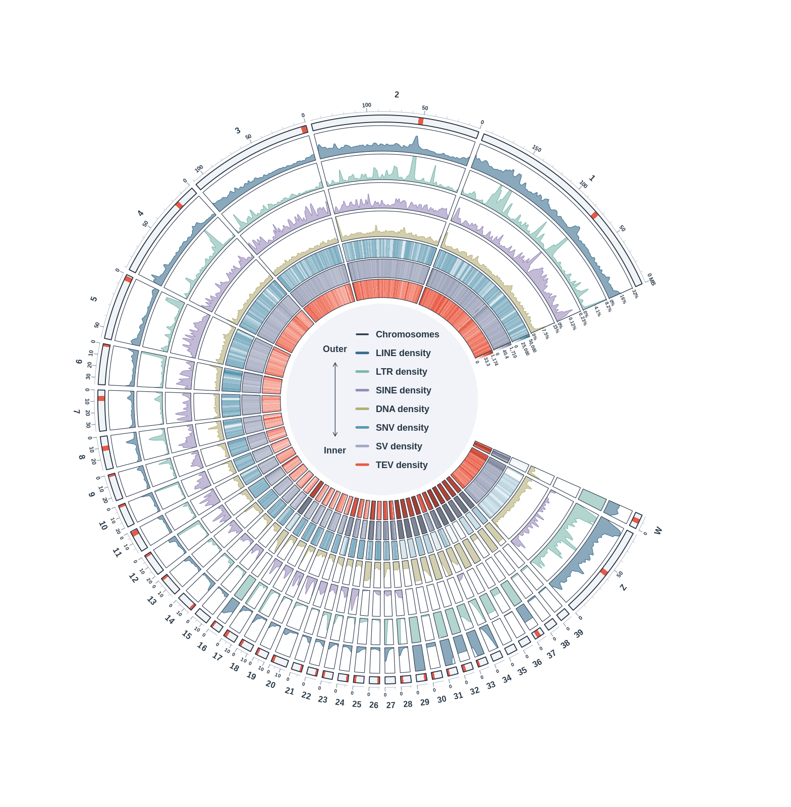
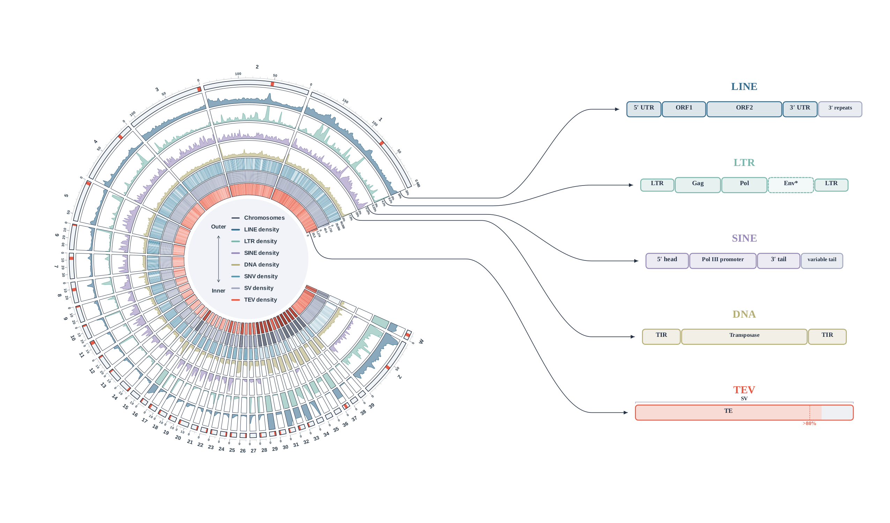
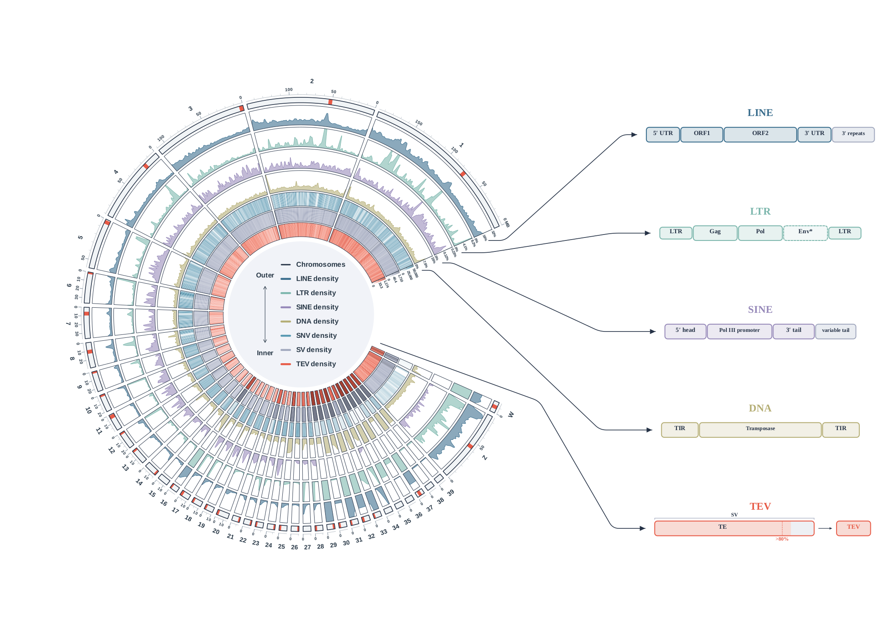
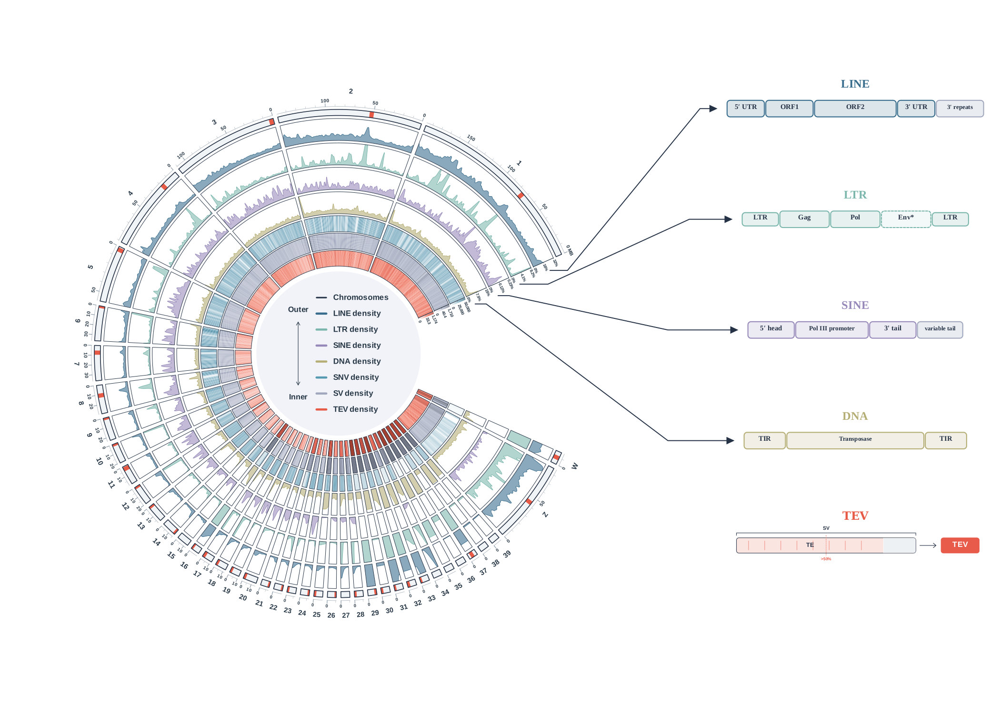
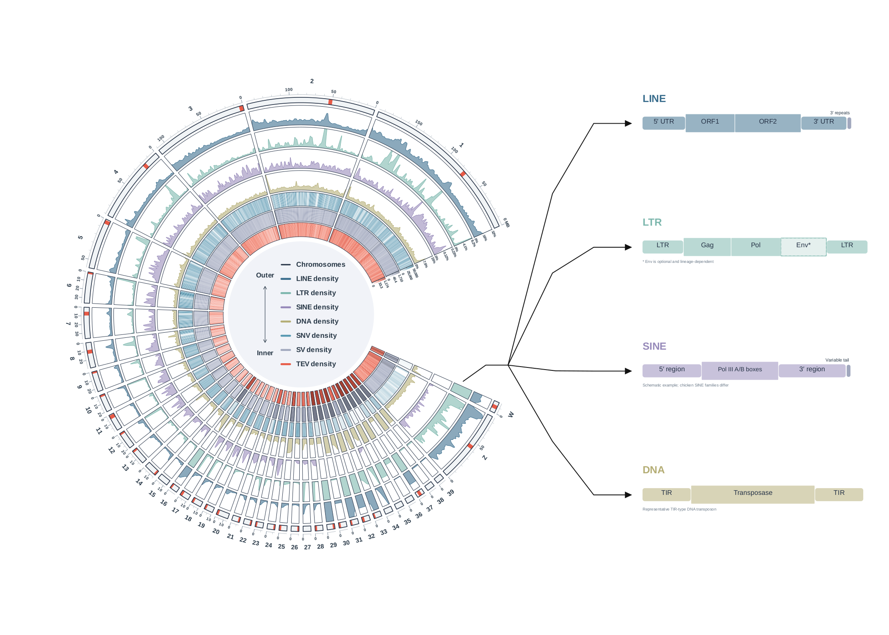

# Fig1 — Chicken GRCg7b TE and variant Circos (V15)

This is the **Circos component of Fig1**, using real GRCg7b data and the repository's `pangenome_spectrum` palette. It is not a replacement for the other Fig1 panels. The final R script and all small inputs needed to redraw are included.



## Latest V3 revision 2: enlarged modules and true upper-track origins

[Complete R compositor](06_scripts/compose_v15_with_te_architectures_v3_r2.R) · [Run/QC](07_figures/R_v15_with_TE_architectures_v3_r2/README.md) · [DEBUG origin zoom](07_figures/R_v15_with_TE_architectures_v3_r2/chicken_GRCg7b_R_v15_with_TE_architectures_v3_r2.DEBUG.anchor_zoom.png)

```bash
bash 06_scripts/run_compose_v15_with_te_architectures_v3_r2.sh
```

Five modules are uniformly1.25× larger on a17×10in page; the original left Circos size/position stays identical. Five independent smooth connectors start at actual upper Chr1 boundaries of tracks4/5/6/7/10. TEV starts on the innermost coral TIP/TEV track at24°, verified against the original SVG polygon. The TEV copy removes its internal arrow/result box. V15, V2, previous V3 and all original assets remain unchanged. DEBUG markers1–5 identify the exact sources.

The illustration retains the requested >80% threshold; unchanged V15 data retain >50% and >50bp. No genomic statistics were recalculated.



## Previous V3: five independent rounded connectors

[Run and QC](07_figures/R_v15_with_TE_architectures_v3/README.md) · [V3 R script](06_scripts/compose_v15_with_te_architectures_v3.R)

```bash
bash 06_scripts/run_compose_v15_with_te_architectures_v3.sh
```

Five modules shift down by 0.60 inches at equal spacing. Four connectors originate near the upper TE tracks; the fifth links the innermost TEV track at the lower opening. All are independent rounded vector paths. V15, V2 and the four TE architecture source SVGs remain unchanged. **The requested TEV schematic shows >80%; V15 density retains >50% and >50 bp. This threshold difference is documented; no genomic data were recalculated.**



## Previous composition (v2): five schematics, upper-track connectors

The latest assembly uses the replacement LINE/LTR/SINE/DNA SVGs and a fifth **TEV classification** schematic. Four independent three-segment arrows originate near the corresponding **upper-right** tracks; no shared stem, intersections or merged vertices. The original V15 and prior composition files remain unchanged.

```bash
bash 06_scripts/install_composition_R_dependencies.sh  # only if needed
bash 06_scripts/run_compose_v15_with_te_architectures_v2.sh
```

[Full v2 R script](06_scripts/compose_v15_with_te_architectures_v2.R) · [v2 README and QC](07_figures/R_v15_with_TE_architectures_v2/README.md)

The user-approved composition-only TEV copy shows **>50%** coverage, aligned to the existing V15 cutoff; its threshold marker is also moved to 50%. The original >80% SVG remains unchanged. This is a schematic, not a reclassification of the V15 data. TEV is not treated as a fifth TE architecture class and has no additional external connector.



## Run

From this folder:

```bash
# R + circlize are required. Install the project-local packages if necessary:
bash 06_scripts/install_circos_R_dependencies.sh
# Validate the actual inputs:
bash 06_scripts/run_circos_R_v15.sh --validate-only
# Export vector PDF/SVG, 600 dpi PNG and a small preview:
bash 06_scripts/run_circos_R_v15.sh
```

The shell entry point works from any current directory. R 4.1.2 and circlize 0.4.18 were used; the font is Liberation Sans. To preserve the committed exports on a rerun, add `--out-dir /absolute/path/to/new_output`. Plotting does not need the original BAM/FASTA/large VCFs. The package installer writes to `06_scripts/R_library`, not a system library.

## Final label change

V15 removes the opening-side `SNP/MB (linear)`, `SV/MB (log1p)` and `TIP/MB (log1p)` titles. Numeric ticks and the narrow gradients stay. The center labels are exactly **SNV density**, **SV density** and **TEV density**. These are display names: the input columns remain `SNP_adaptive_discovery_per_Mb`, `SV_per_Mb` and `TIP_extended_per_Mb`. No data or biological definitions changed.

## Data and interpretation

- All seven tracks use the same real **1,000,000 bp** window framework (1063 windows, actual-length terminal windows), GRCg7b coordinates and chromosome order 1–39/Z/W. The right opening is 48°, Chr1 starts upper-right and proceeds counterclockwise. Microchromosomes have display-angle enlargement; within-sector coordinates remain true bp.
- Four outer TE tracks are reference-assembly **within-class union coverage**, not polymorphism counts. Independent percent caps: LINE32%, LTR8.2%, SINE0.23%, DNA15%. LTR cap is raw q95, the others q99, rounded up to two significant digits; raw high windows are retained in the tables. Display smoothing and explicit annular clipping are unchanged from V14.
- **SNV density** is assembly-derived biallelic SNP discovery, not population allele frequency or joint sex-balanced genotyping. It includes the real Z/W recovery described in `docs/ZW_discovery_V11.md`. Default total: 20,552,376 independent sites. Linear cap50,000 per million reference bases.
- **SV density** is the existing Jasmine independent-site panel (123,901 sites), with the existing log1p display and midpoint window assignment. Panels are not pooled.
- **TEV density** retains the **extended** TIP/repeat-polymorphism panel (66,804 sites): includes INS/DEL and simple repeat/low complexity/satellite in addition to strict TE classes. It is not an insertion-only strict-TE count; the center rename does not narrow this dataset. Existing log1p display is retained.
- Density units, though their axis titles are intentionally omitted, remain **sites per 1,000,000 reference bases** (MB in the previous user-specified display). TE remains coverage (%). All scale/cap/clip information is in `track_scales.tsv`.
- Main plot has 34 transferred/approximate centromere candidates from35 supplied GGswu (GCA_024206055.2) intervals. One candidate maps principally to an unplaced sequence. Five candidates are only flank-bounded, not centromeric-core matches. GRCg7b15/27/34/35/36/38/39 have no supported marker. Red glyph width is schematic. These are not CENP-A validated coordinates; see `01_reference/v14/` and `docs/centromere_and_clipping_QC_V14.md`.

## Fixed colors

|Track|HEX|
|---|---|
|LINE|#386C8C|
|LTR|#7BB6AC|
|SINE|#9689B9|
|DNA|#B4AD74|
|SNV|#5899B2|
|SV|#A1A8BE|
|TEV|#E75A46|

Outline#253246, text#273746, white background; uniform ideogram#F1F4F6; full-height coral centromere glyphs. Root repository style is the visual source. The previously user-approved Circos-specific layout, independent coverage caps and density gradients remain; the GWAS-specific statistics and89-trait requirements do not apply to this density figure.

## Materials and provenance

`MATERIALS.tsv` records the original local paths, file sizes, publication decisions and SHA256 for included source materials. Small plotting tables, reference TE BEDs, aggregate annotation catalogs, sites-only Z/W VCF and centromere evidence are included. **No individual-level genotype matrix, phenotype matrix, raw GWAS matrix, BAM or FASTA is uploaded.** Larger VCFs and raw references/alignment sources remain at the recorded local paths; these paths are provenance, not public download URLs. The final images are included even when larger than the small-input cutoff.

The R input/output manifests preserve the original execution paths; the script resolves the included inputs relative to this folder after clone. `repository_files.sha256.tsv` checks the published files independently of those original machine paths. Optional historical preparation scripts have their original workspace dependencies and are not needed for redraw. The statistical preparation pipeline was not rerun for this label update.

Validation: exact seven-track input hashes, curves, scales, colors, centromere marks and heat colors match V14; actual PDF text has the requested center labels and no opening-side unit titles. Actual PNG is5880×6000 at600dpi. See `07_figures/R_v15/validation_report.json` and `portable_validation.json`.


## Compose V15 with the TE architecture callouts

The original V15 files and plotting code remain unchanged. A separate R compositor reads the finalized SVG and the four original architecture SVGs from `assets/TE_architectures/`. It preserves the original annular clips, embeds editable structure text, and adds one short lower-right stem with four black fan-out arrows. The callouts are schematic type illustrations, not genomic mappings.

```bash
bash 06_scripts/install_composition_R_dependencies.sh
bash 06_scripts/run_compose_v15_with_te_architectures.sh
# Fast SVG/preview-only iteration:
bash 06_scripts/run_compose_v15_with_te_architectures.sh --preview-only
```

See the [complete R composition script](06_scripts/compose_v15_with_te_architectures.R) and [composition README/QC](07_figures/R_v15_with_TE_architectures/README.md). Page14×10in; vector PDF/SVG; PNG8400×6000 at600dpi. Positions and arrow bends are in `composition_config()`, in physical inches.


